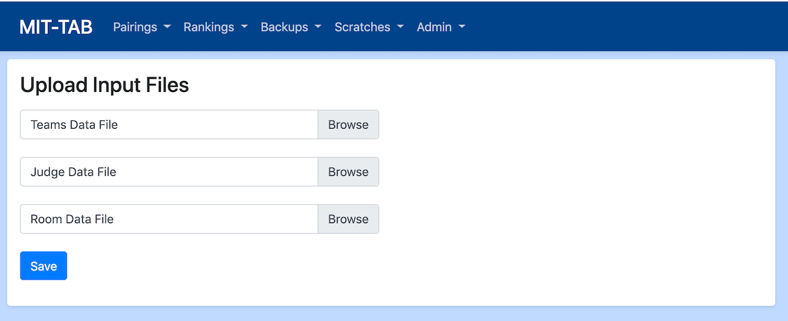
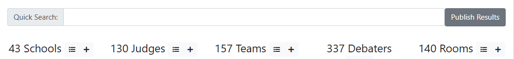

# Adding Teams, Judges, Rooms, and Debaters

There are two ways to enter teams, judges, rooms, and debaters:
[Manually entering individually](#manual-data-entry) or
[importing data in batches](#batch-data-import). In most cases, the batch
import is probably easier. However, you may need to enter data manually to add
one or two teams at a time, or to fix any errors that may have occurred when
importing data in bulk.

(batch-data-import)=
## Batch Data Import

To import data in bulk: First, navigate to the "File Data Upload" link under
the "Admin" section of the navigation menu:

Then, you should see a page where you can add a file for judges, rooms and teams:

Upload **CSV, XLS, or XLSX** files for teams, judges, rooms, and scratches. Excel
imports read the first worksheet. Save CSV files with UTF-8 encoding. Blank rows
are skipped. If any row fails validation, all records and audit events created by
that file are rolled back; correct the reported values and upload the file again.
Errors identify the spreadsheet row, column, offending value, and validation rule.

Download an export from the same page to get the current column headers and order.
Exports are available in all three formats and can be imported into another
tournament. Roster imports create records; they do not replace existing names.
Scratch exports require permission to view scratches. APDA Board accounts use the
separate school/debater APDA ID import/export controls, also available in all three
formats; these update IDs on existing records only.

### Column detection

The importer tries the default column order first, then named headers (ignoring
case, spaces, and punctuation), then recognizable data such as email addresses,
numeric calibrations, and scratch types. Headers are optional for data in the
default order. A recognized header row is skipped; the first data row is retained
in a file without headers. When rearranging columns, keep the exported headers.
Ambiguous text columns need names: the importer cannot reliably distinguish a
team name, school name, and debater name from their values alone.

Default columns, from left to right:

| Spreadsheet | Columns |
| --- | --- |
| Teams | Team name, School, Hybrid school, Seed, Debater 1 name, Debater 1 status, Debater 1 email, Debater 1 APDA ID, Debater 2 name, Debater 2 status, Debater 2 email, Debater 2 APDA ID |
| Judges | Judge name, Judge email, Calibration, then affiliated schools and expected rounds |
| Rooms | Room name, Rank |
| Scratches | Team name, Judge name, Scratch type |

Seed accepts full, half, free, or unseeded (blank also means unseeded). Debater
status accepts novice or varsity, including `N`/`V`; blank means varsity.
Scratch type accepts team or tab. Optional omitted columns in a named layout
are treated as blank.

### Judge spreadsheet columns

- Column A: Judge name.
- Column B: Judge email (optional).
- Column C: Calibration (also recognized as Judge Rank).
- Columns D onward: Affiliated schools, one per column, with headers `School 1`,
  `School 2`, etc. Blank cells are ignored.
- The final *N* columns (*N* is the **Total Rounds** setting) represent the rounds
  the judge is expected to attend. Use headers `Round 1 expected` through
  `Round N expected` (or `R1` through `RN`). Use `Y`, `Yes`, `True`, `1`, `X`,
  or `In` for expected rounds; use a blank, `No`, `False`, `0`, or `Out` otherwise.
  Named expected-round columns can be reordered or omitted.

Expected rounds populate the “Expected Judges” tab in batch check-in and the
public judge list. Judge exports retain affiliated schools and expected rounds.

(manual-data-entry)=
## Manual Data Entry

From the home page, you can add and view all _Schools, Judges, Teams, Debaters,
and Rooms_.  To enter information quickly, you should have multiple people
reading through your registration information and entering it into the program
at any given moment.

### Schools
1. Name - Name of the school, e.g. "Yale"

### Judges
1. Name - Name of the judge.
2. Email - Optional email address used for sending judge portal links.
3. Rank - A number from 0.0 - 99.99 that represents the relative ranking of this
judge. Higher is a "better" judge.
4. Affiliated Schools - A list of schools that this judge should be unable to
judge. **Use this for team scratches as well as multiple affiliations**
5. Wing Only - Check this box if the judge can only serve as a wing judge and not as a chair. Wing-only judges will be excluded from automatic chair assignment during both in-rounds and outrounds. This is useful for ensuring that less experienced judges are never assigned as the chair of a panel.

**Note:** Judges automatically get assigned unique judge codes (e.g., "wandering-tsunami-234567", "icy-firefly-89abcd") when created. These codes allow judges to open the judge portal, update expected availability, and submit e-ballots remotely. You can find a judge's code:
- In the judge list view (appears in parentheses after the name)
- On the judge detail page
- Judge codes can be used from the mit-tab homepage under Judge Portal and Ballots.

### Teams
1. Name - Name of the team, e.g. "Yale A"
2. School - School that this team should be protected from in pairing. If you
are entering a hybrid, select the team that has protection.
3. Hybrid school - For hybrids, the school they are not taking protection from.
This will prevent the team from being judged by this school, but not from
hitting teams from that school
4. Debaters - The debaters on this team, up to two debaters may be chosen and
you can add a debater directly (instead of having to enter them separately)
using the button to the right of the selection box.  If you select one debater
then the program will treat the team as an iron man team.
5. Seed - The seed of the team, used during the first round pairing.
6. Break Preference - Whether this team prefers to break varsity or novice.
This affects outround breaking if a novice team qualifies for the varsity break.
7. Checked in - If this box is checked then any rounds you pair will include
this team in the pairing. Uncheck this if you want the team to not be paired
into the rounds.
8. Scratch Count - Used for generating a form that allows you to immediately
add scratches.  Feel free to put zero and add scratches later (they can be
added from either the judge page or the team page at any time).

**Note:** Teams automatically get assigned unique team access codes in the same word-word-code format as judge and registration codes. Team codes are authentication tokens for the team portal and are not displayed on pairings or staff views.

### Debaters
1. Name - Name of the debater, e.g. "Matt Smith".
2. Novice status - Varsity or novice, used by the program to determine novice
team/debater rankings.

### Rooms
1. Name - Name of the room.
2. Rank -  A number from 0.0 - 99.99 that represents the relative ranking of
this room.  Higher is a "better" room, and higher ranked rooms will be paired
in before other rooms.
